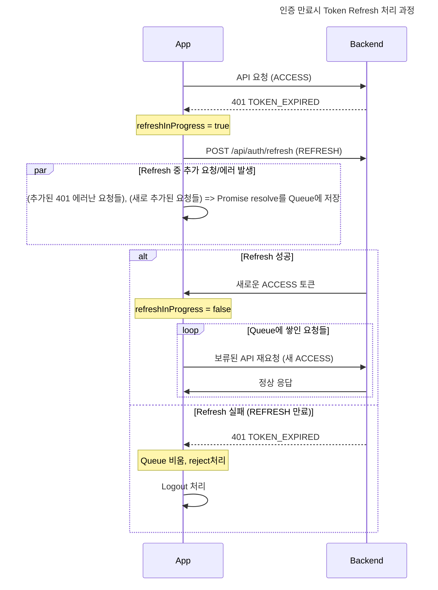

# Diagram

# Notes

* `refreshInProgress` 플래그로 중복 refresh 요청을 방지하고, 그 사이 발생한 요청은 Promise Queue에 보류한다.
* REFRESH 토큰까지 만료되면 큐를 reject 처리하고 로그아웃한다. 최초 로그인 흐름은 [PKCE 구글 로그인](./google-login-pkce.md) 참고.
